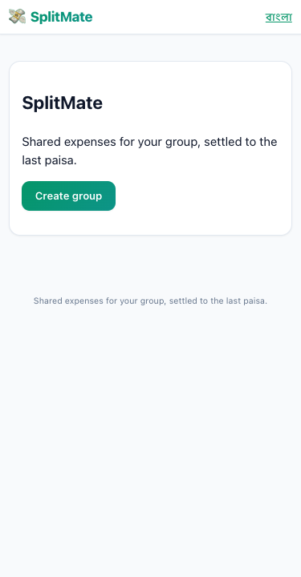
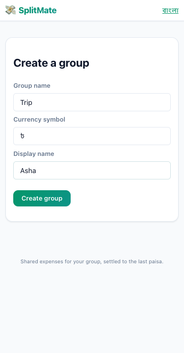
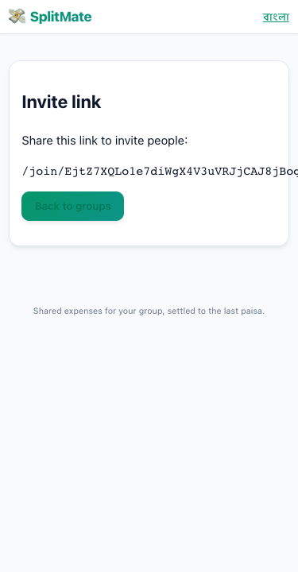
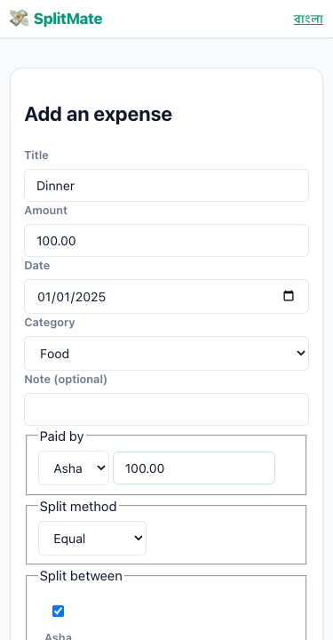
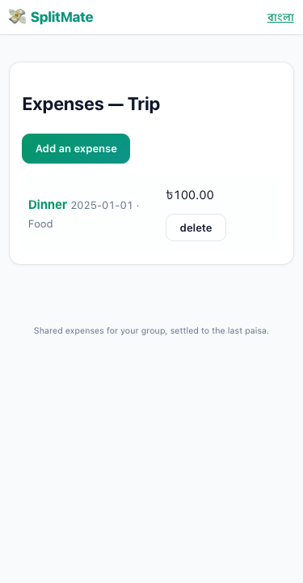
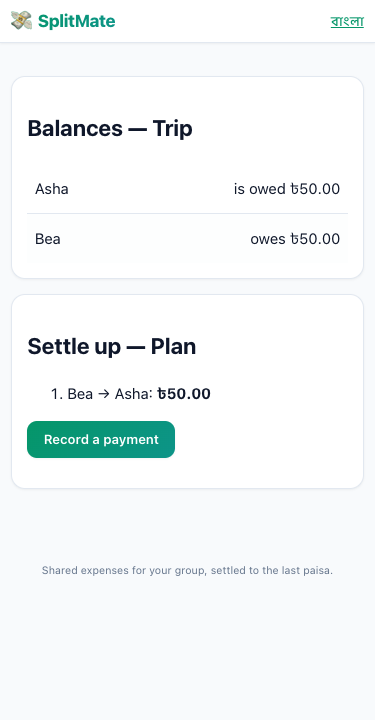
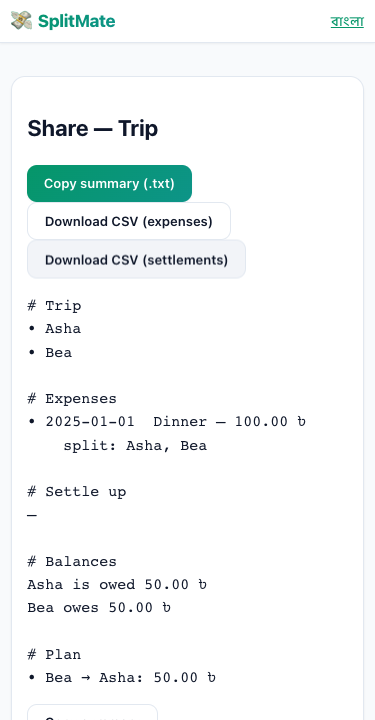
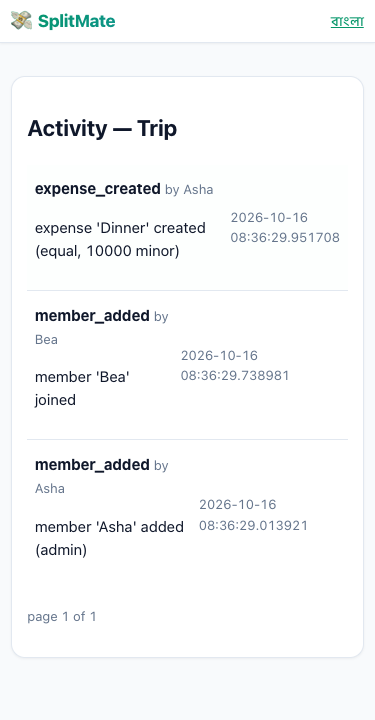

# SplitMate

Shared expenses and balances for friend groups, settled to the last
paisa.

SplitMate is a small, opinionated web app: create a group, share an
invite link, log expenses, see who owes whom, and record settlements.
Everything is computed from the ledger on every read, so balances can
never drift.

* **Stack** — Python 3.12, FastAPI, SQLModel, Alembic, PostgreSQL
  (SQLite for dev), Jinja2, vendored HTMX, vanilla JavaScript
  ES modules.
* **Storage** — every amount is stored as integer minor units
  (e.g. BDT paisa).  No floats anywhere on the wire.
* **Languages** — English and Bangla; both dictionaries live in
  `splitmate/i18n/`.
* **Tested** — 158 unit / property tests, 1 Playwright end-to-end
  test, ruff clean.

## Screenshots

| Home & Welcome | Create Group Form | Group Dashboard |
| :---: | :---: | :---: |
|  |  |  |

| Member Join Link | Add Expense Form | Expense Saved |
| :---: | :---: | :---: |
|  |  |  |

| Net Balances | Group Summary | Activity Stream |
| :---: | :---: | :---: |
|  |  |  |

## Quick start (local, SQLite)

```sh
# 1. Clone and install
git clone <your-fork> splitmate
cd splitmate
python3.12 -m venv .venv
.venv/bin/pip install -e '.[dev]'

# 2. Configure
cp .env.example .env
# (the default SECRET_KEY is fine for local development)

# 3. Migrate + seed + run
.venv/bin/alembic upgrade head
.venv/bin/python -m splitmate.seed
.venv/bin/uvicorn splitmate.main:app --reload
```

Open <http://127.0.0.1:8000>.  The demo group has 4 members,
12 expenses, and 2 settlements ready to explore.

## Quick start (docker compose, Postgres)

```sh
cp .env.example .env
# Edit .env and set a real SECRET_KEY:
#   python3.12 -c "import secrets; print(secrets.token_urlsafe(32))"
docker compose up --build
```

The first run applies Alembic migrations and seeds the demo group.
Data persists in the `db_data` named volume.

## Tests

```sh
.venv/bin/python -m pytest                # everything except e2e
.venv/bin/python -m pytest tests/e2e      # Playwright end-to-end
.venv/bin/python -m ruff check .          # lint
```

The test suite is fully isolated: every test gets its own tmp-path
SQLite database.  The CI workflow (`.github/workflows/ci.yml`) runs
the same suite against PostgreSQL to catch dialect-specific bugs.

## Project layout

```
splitmate/
  config.py          pydantic-settings, env-driven
  db.py              engine + session
  models.py          SQLModel ORM
  money.py           integer-only money helpers
  security.py        token hashing, rate limiter, session helpers
  security_headers.py  CSP + defensive headers middleware
  seed.py            demo seed (idempotent)
  split_engine/      pure logic for equal/exact/percentage/shares
  services/          business rules (groups, members, expenses, …)
  web/               FastAPI routes (thin)
  templates/         Jinja2 .j2 templates
  static/            CSS, JS, vendored HTMX
  i18n/              en.json, bn.json
  i18n.py            translation helper
  main.py            app factory

tests/               pytest unit + property + e2e
alembic/             hand-written migrations
docs/screenshots/    Playwright captures
```

## Features at a glance

* **Groups** with secret invite links (rotatable, revocable, ≥128-bit
  token, stored as SHA-256 hash).
* **Members** with display names unique inside a group, an
  HttpOnly + SameSite=Lax session cookie, and one-time 24-hour
  re-link codes (rate-limited to 5 attempts per 15 minutes per
  IP and group).
* **Expenses** with four split methods — equal, exact, percentage
  (basis points), and shares (integers).  Every split sums exactly
  to the total via the largest-remainder method; ties are broken
  starting at index `(expense_id mod participants)` in member-id
  order so no one is always charged the extra paisa.
* **Settlements** record real-world payments (cash, bKash, Nagad,
  bank, other) and immediately update balances.
* **Activity feed** (paginated) records every change with a
  before/after summary.
* **Settle-up plan** uses a greedy algorithm: match the largest
  creditor with the largest debtor, repeat.  At most N-1 transfers.
* **Idempotency keys** make expense retries safe; the same key
  posted twice creates one expense.
* **CSV export** neutralises formula-injection (`= + - @` tab, CR
  are prefixed with a single quote) and includes a UTF-8 BOM for
  Excel-friendly viewing.
* **Plain-text summary** — `GET /groups/{id}/summary.txt` —
  suitable for pasting into a chat.
* **Strict CSP**, `X-Frame-Options: DENY`, `Referrer-Policy:
  no-referrer`, `X-Content-Type-Options: nosniff`.

## Production checklist

* `SECRET_KEY` is a fresh 32-byte random string (the app refuses
  to start in `ENV=production` with the placeholder key).
* `DATABASE_URL` points to a managed Postgres with backups.
* HTTPS is terminated upstream; cookies are `Secure` automatically
  in production.
* The seed (`python -m splitmate.seed`) is idempotent and safe to
  run on every deploy.

See [DEPLOY.md](DEPLOY.md) for Render / docker / bare-metal recipes
and [smoke_test.sh](smoke_test.sh) for a post-deploy health check.

## License

MIT — see the file header on each module.
